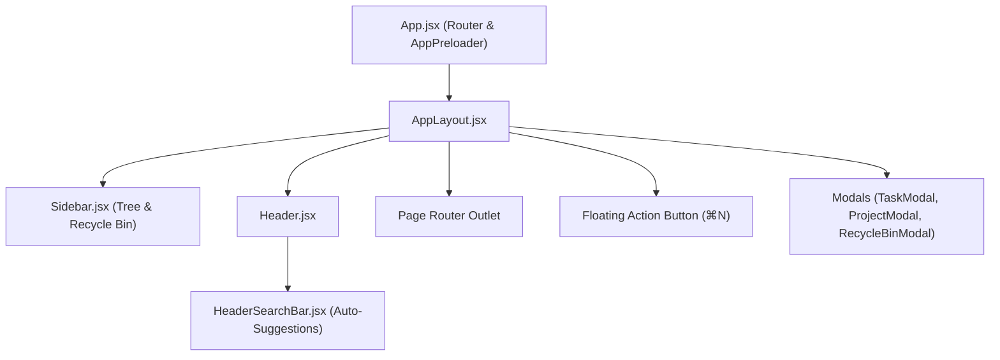

# devOrbit Architecture & Technical Overview

This document provides a comprehensive architectural guide for developers working on the **devOrbit** codebase.

---

## 1. System Overview

devOrbit is a developer-first project and task workspace engineered for software engineering workflows. It provides:
- **Hierarchical Project Trees**: Parent projects and nested sub-projects.
- **Task Management**: Multi-column Kanban board (Hot Fix, Current, Later, collapsible Done), multi-item selection, and clipboard operations.
- **Specification Prompts**: 1-click copyable task prompts formatted for AI pairing and prompt engineering.
- **Rich Markdown Engine**: Markdown rendering with syntax-highlighted code blocks, 1-click code copying, and search keyword highlighting.
- **30-Day Recycle Bin & Undo**: Soft deletion of tasks and projects with 30-day retention and instant `Cmd+Z` undo stack recovery.
- **Global Header Search**: Inline suggestion popover without blocking modals, with persistent keyword highlighting across screens.
- **Local-First Resilience**: Zero backend dependencies; all data is normalized, validated, and persisted in browser storage with single-file JSON backup/restore.

---

## 2. Directory Structure

```text
devOrbit/
├── docs/                           # Developer documentation
│   ├── ARCHITECTURE.md             # This document
│   ├── DATA_MODEL.md               # Data structures & storage schemas
│   ├── STATE_MANAGEMENT.md         # React context & undo stack architecture
│   ├── FEATURES_GUIDE.md           # Deep dive into features
│   ├── SHORTCUTS.md                # Keyboard shortcuts reference
│   └── CONTRIBUTING.md             # Contribution & testing guide
├── public/                         # Static assets, icons, manifest
├── src/
│   ├── components/
│   │   ├── analytics/              # Heatmap and progress charts
│   │   ├── common/                 # Reusable UI primitives (Buttons, Badges, Modals, Markdown)
│   │   │   ├── AppPreloader.jsx    # 2.2s sober preloader with 30-day purge
│   │   │   ├── Badge.jsx           # Status & priority indicators
│   │   │   ├── Button.jsx          # Standardized button component
│   │   │   ├── ConfirmDialog.jsx   # Accessible confirmation dialogs
│   │   │   ├── Icons.jsx           # SVG icons (e.g. GitHub)
│   │   │   ├── MarkdownRenderer.jsx# Lightweight secure markdown renderer
│   │   │   ├── Modal.jsx           # Generic accessible modal wrapper
│   │   │   └── ProjectAvatar.jsx   # Project initials and custom logo avatar
│   │   ├── landing/                # Welcome screen when workspace is empty
│   │   │   └── LandingWelcomeScreen.jsx
│   │   ├── layout/                 # Application shell
│   │   │   ├── AppLayout.jsx       # Main layout, FAB button, modals & shortcuts
│   │   │   ├── Header.jsx          # Top bar with project context & search
│   │   │   ├── HeaderSearchBar.jsx # Inline search bar with auto-suggestions
│   │   │   └── Sidebar.jsx         # Resizable navigation with project tree
│   │   ├── notes/                  # Project markdown notes editor
│   │   ├── projects/               # Project modal, cards, and headers
│   │   │   ├── ProjectCard.jsx     # Overview card with links and author
│   │   │   ├── ProjectHeader.jsx   # Project title banner with metadata
│   │   │   └── ProjectModal.jsx    # Project editor with color picker & README
│   │   └── tasks/                  # Task board, lists, cards, and detail
│   │       ├── MarkdownSyncModal.jsx# Import/export markdown task lists
│   │       ├── RecycleBinModal.jsx # 30-day soft-delete recovery manager
│   │       ├── TaskCard.jsx        # Kanban card with prompt copy & selection
│   │       ├── TaskFilterBar.jsx   # Filter by status, priority, tags, hotfix
│   │       ├── TaskKanbanBoard.jsx # 3 top columns + bottom collapsible Done
│   │       ├── TaskKanbanColumn.jsx# Drag & drop task column container
│   │       ├── TaskListView.jsx    # Alternative list layout
│   │       └── TaskModal.jsx       # Task creator/editor with draft auto-save
│   ├── context/                    # React Context providers
│   │   ├── ThemeContext.jsx        # Dark/light theme switching & persistence
│   │   ├── ToastContext.jsx        # Toast notification queue
│   │   └── WorkspaceContext.jsx    # Central state store & domain methods
│   ├── hooks/                      # Custom hooks
│   │   ├── useKeyboardShortcuts.js # Capture-phase keyboard shortcuts listener
│   │   ├── useProjectStats.js      # Metric calculations
│   │   └── usePWAInstall.js        # Progressive Web App installation hook
│   ├── pages/                      # Top-level view routes
│   │   ├── DashboardOverviewPage.jsx# Workspace root dashboard
│   │   ├── ProjectOverviewPage.jsx # Project overview & README.md display
│   │   ├── ProjectTasksPage.jsx    # Project Kanban & List tasks view
│   │   ├── ProjectAnalyticsPage.jsx# Project activity heatmap & metrics
│   │   ├── ProjectNotesPage.jsx    # Project documentation notes
│   │   ├── TaskDetailPage.jsx      # Dedicated full-screen task display
│   │   └── SettingsPage.jsx        # Workspace data export, import, reset
│   ├── utils/                      # Core business logic & helpers
│   │   ├── activityGenerator.js    # Heatmap activity matrix generation
│   │   ├── idGenerator.js          # Collision-free ID generation
│   │   ├── imageUtils.js           # Client-side logo compression & initials
│   │   ├── markdownParser.js       # Markdown task export & import parsing
│   │   └── storage.js              # Schema sanitization & 30-day purge
│   ├── App.jsx                     # Root router & preloader wrapper
│   ├── index.css                   # Global styles & design system rules
│   ├── main.jsx                    # React entry point
│   └── theme.css                   # Dark & light CSS variables
├── tests/                          # Automated unit test suite
│   ├── markdownParser.test.js      # Markdown import/export tests
│   ├── recycleBin.test.js          # Soft delete, restore, retention, undo
│   ├── storage.test.js             # Data sanitization & 30-day purge
│   └── taskOperations.test.js      # Selection, clipboard, draft persistence
└── package.json
```

---

## 3. Component Hierarchy & Layout



---

## 4. Design System & CSS Variable Architecture

devOrbit implements an adaptive design system toggling between dark (default) and light themes via CSS custom properties declared in `src/theme.css`:

| Category | CSS Variable | Purpose |
|---|---|---|
| Backgrounds | `--bg-app`, `--bg-surface`, `--bg-header` | Elevation layers |
| Accents | `--color-primary`, `--color-primary-light` | Brand blue accents |
| Hotfix Status | `--status-hotfix-solid`, `--status-hotfix-bg` | Critical hotfix indicators (`#f43f5e`) |
| Current Status | `--status-current-solid`, `--status-current-bg` | Active in-flight tasks |
| Later Status | `--status-later-solid`, `--status-later-bg` | Backlog / planned items |
| Done Status | `--status-done-solid`, `--status-done-bg` | Completed milestone items |
| Inputs | `textarea { resize: vertical !important; }` | Enforces vertical-only resizing |

