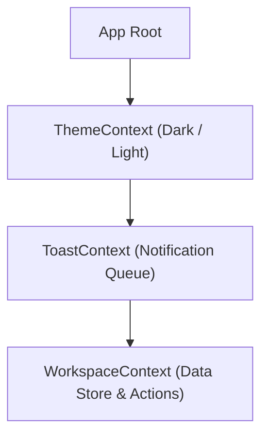
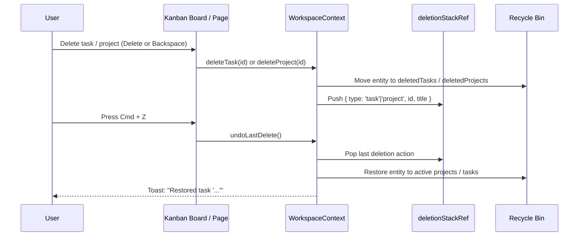

# devOrbit State Management & Context Architecture

This document describes state flow, optimistic updates, and undo architecture in devOrbit.

---

## 1. Context Architecture

devOrbit manages application state through three focused React Context providers:

---

## 2. WorkspaceContext (`src/context/WorkspaceContext.jsx`)

The primary source of truth for all domain entities.

### Core State Variables
- `data`: Complete `WorkspaceData` object (`projects`, `tasks`, `notes`, `deletedTasks`, `deletedProjects`).
- `activeProjectId`: Currently selected project ID (or null for root workspace).
- `searchKeyword`: Globally highlighted search keyword across views.
- `deletionStackRef`: In-memory LIFO stack tracking recently deleted entities for `Cmd+Z` undo.

### Key Domain Methods
| Method | Signature | Description |
|---|---|---|
| `createProject` | `(data) => Project` | Initializes project with author, readme, live URL, and color |
| `updateProject` | `(id, updates) => void` | Updates project attributes with timestamp |
| `deleteProject` | `(id) => void` | Soft-deletes project and its tasks to `deletedProjects` |
| `restoreProject` | `(id) => string` | Restores soft-deleted project and all its associated tasks |
| `permanentlyDeleteProject` | `(id) => void` | Permanently deletes project from Recycle Bin |
| `createTask` | `(data) => Task` | Creates task; auto-assigns status `hotfix` if tagged |
| `updateTask` | `(id, updates) => void` | Updates task; triggers confetti if marked `done` |
| `updateTaskStatus` | `(id, status) => void` | Transitions task between `hotfix`, `current`, `later`, and `done` |
| `deleteTask` | `(id) => void` | Soft-deletes task to `deletedTasks` with 30-day retention |
| `deleteMultipleTasks` | `(ids[]) => void` | Batch soft-deletes tasks to `deletedTasks` |
| `restoreTask` | `(id) => void` | Restores soft-deleted task back to its project |
| `restoreMultipleTasks` | `(ids[]) => void` | Batch restores soft-deleted tasks |
| `undoLastDelete` | `() => { success, message }` | Pops top deletion action and restores item (`Cmd+Z`) |
| `emptyRecycleBin` | `() => void` | Permanently clears all deleted tasks and deleted projects |

---

## 3. Undo Deletion Architecture (`Cmd + Z`)

### Safety Rules for Undo
- If user is typing inside an `<input>`, `<textarea>`, or contentEditable element, `Cmd+Z` is **not** intercepted, preserving native text input undo.
- Only non-input keystrokes trigger domain entity restoration.

